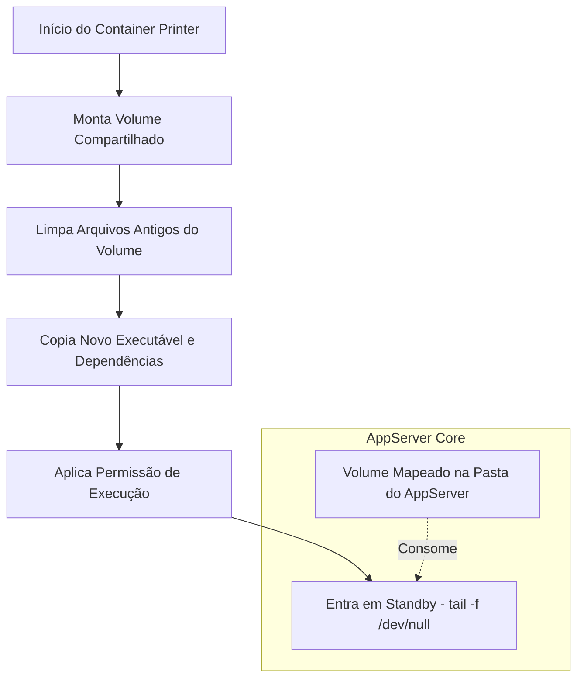

# Docker Protheus Printer 🖨️

Este repositório contém a infraestrutura de containerização e entrega automatizada do **TOTVS Printer** para o ecossistema TOTVS Protheus Docker DevOps Stack.

A imagem foi projetada sob o conceito de **Delivery Container** (um container efêmero de provisionamento de ativos), eliminando a necessidade de acoplar o Printer diretamente na imagem base do AppServer.

---

## 🏗️ Arquitetura de Entrega

O container do Printer é inicializado de forma síncrona com a stack. Ele monta um volume compartilhado com o AppServer, limpa versões legadas, injeta os binários atualizados e entra em standby, garantindo governança sem consumo de recursos do host.



### 🚀 Tecnologias e Otimizações

* `Multi-Stage Build (Alpine)`: O estágio de compilação extrai o pacote e o estágio de execução utiliza uma imagem limpa do Alpine Linux 3.19.

* `Mágica do Strip`: Todos os binários passam por uma depuração via strip recursivo no estágio de build, removendo símbolos de debug desnecessários e otimizando o tamanho final da imagem.

* `Flexibilidade de Artefatos`: O pipeline aceita qualquer arquivo .tar.gz oficial da TOTVS sem necessidade de renomeação manual (ex: 26-06-23-PRINTER_LINUX_X64.TAR.GZ).

### 🏷️ Rastreabilidade de Build

A tag da imagem publicada permanece fixa (`3.0.5`) entre builds — só muda quando a `TOTVS` libera uma nova versão do Printer. Para rastrear qual commit gerou um build específico sem depender da tag, o `pipeline` grava o label `org.opencontainers.image.revision` com o SHA do commit em toda imagem publicada:

```bash
docker inspect --format '{{ index .Config.Labels "org.opencontainers.image.revision" }}' rodrigomicrosiga/printer-dev:3.0.5
```

### 🛠️ Como Contribuir e Atualizar

Se uma nova versão do `TOTVS Printer` for disponibilizada pela `TOTVS`:

* Baixe o pacote oficial .tar.gz do portal.

* Coloque o arquivo compactado na raiz deste repositório (ou no nível acima, conforme configurado no `Runner`).

* Atualize a tag de versão no `Dockerfile`, `entrypoint.sh` e no `workflow` `.github/workflows/docker-publish.yml`.

* Realize o `commit` e envie para a branch correspondente para disparar o `pipeline` do `GitHub Actions`.