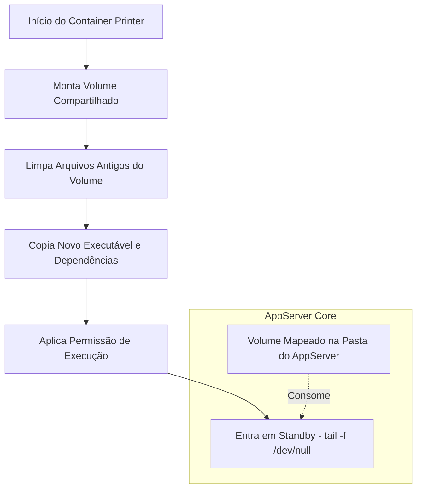

# Docker Protheus Printer 🖨️

Este repositório contém a infraestrutura de containerização e entrega automatizada do **TOTVS Printer** para o ecossistema TOTVS Protheus Docker DevOps Stack.

A imagem foi projetada sob o conceito de **Delivery Container** (um container efêmero de provisionamento de ativos), eliminando a necessidade de acoplar o Printer diretamente na imagem base do AppServer.

---

## 🏗️ Arquitetura de Entrega

O container do Printer é inicializado de forma síncrona com a stack. Ele monta um volume compartilhado com o AppServer, limpa versões legadas, injeta os binários atualizados e entra em standby, garantindo governança sem consumo de recursos do host.



### 🚀 Tecnologias e Otimizações

* `Multi-Stage Build (Alpine)`: O estágio de compilação extrai o pacote e o estágio de execução utiliza uma imagem limpa do Alpine Linux 3.19.

* `Mágica do Strip`: Todos os binários passam por uma depuração via strip recursivo no estágio de build, removendo símbolos de debug desnecessários e otimizando o tamanho final da imagem.

* `Flexibilidade de Artefatos`: O pipeline aceita qualquer arquivo .tar.gz oficial da TOTVS sem necessidade de renomeação manual (ex: 26-06-23-PRINTER_LINUX_X64.TAR.GZ).

### 🏭 Build e publicação

Esta imagem é construída pelo workflow central **`Build image`** do repositório privado `protheus-catalog` — este repositório não tem workflow de publicação, e um push aqui **não** publica nada.

1. O catálogo guarda, por release, um manifesto (`releases/<release>/manifest.yaml`) com o caminho, o tamanho e o sha256 de cada arquivo oficial da TOTVS que compõe a imagem.
2. `scripts/stage-image.sh <release> <imagem> <dir>` copia esses arquivos para um contexto limpo, **conferindo tamanho e sha256 antes e depois da cópia**; qualquer divergência aborta o build.
3. O workflow acrescenta o `Dockerfile` e o `entrypoint.sh` deste repositório e roda `docker build --build-arg PRINTER_VERSION=<versão do manifesto>`. Só publica com `push=true` e **recusa uma tag que já exista** no Docker Hub.

* **Tag:** a versão do Printer (ex.: `3.0.5`).
* **Build-arg:** `PRINTER_VERSION` (obrigatório, sem valor padrão).
* Os pacotes oficiais da TOTVS não são versionados aqui (`.gitignore`).

### 🏷️ Rastreabilidade de Build

A tag da imagem publicada permanece fixa (`3.0.5`) entre builds — só muda quando a `TOTVS` libera uma nova versão do Printer. Para rastrear qual commit gerou um build específico sem depender da tag, o `pipeline` grava o label `org.opencontainers.image.revision` com o SHA do commit em toda imagem publicada:

```bash
docker inspect --format '{{ index .Config.Labels "org.opencontainers.image.revision" }}' rodrigomicrosiga/printer-dev:3.0.5
```

### 🛠️ Como atualizar

Se a TOTVS liberar uma nova versão do Printer: baixe o pacote oficial `.tar.gz` para o pouso de artefatos, ajuste a versão/padrão em `releases/<release>/sources.txt` do `protheus-catalog`, rode `scripts/release-sync.sh <release>` (recalcula o manifesto) e dispare o workflow `Build image`. Nada é colocado neste repositório.
